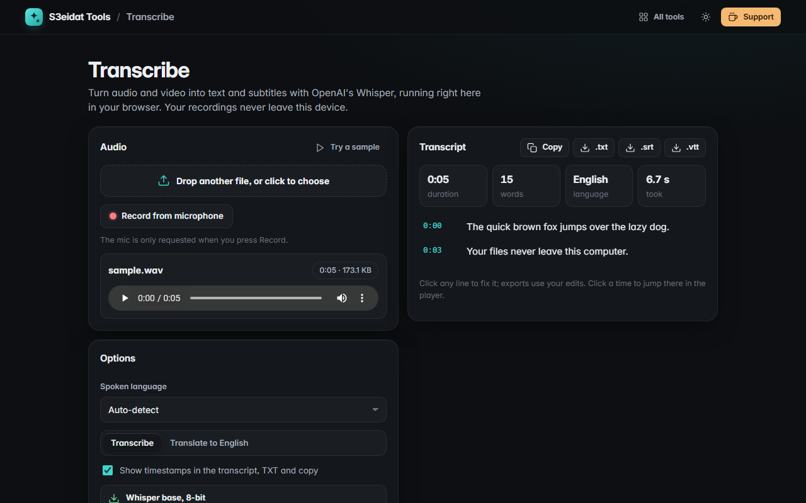

# Transcribe

> Audio and video to text and subtitles with OpenAI Whisper, running in your browser. Free, private, nothing uploaded.

### ▶ [Open Transcribe](https://s3eidat.github.io/transcribe/)



## Features

- **Any audio or video file** your browser can play (MP3, WAV, M4A, OGG/Opus, FLAC, MP4, WebM, MOV…), or **record from the microphone** (only asked for when you press Record)
- **Whisper base** speech recognition, 8-bit quantized, running locally on your CPU with WebAssembly in a background worker, so the page stays responsive
- **Language**: auto-detect (Whisper's own language guess) or pick one: Arabic, English, French, Spanish, Turkish, German, Persian, Urdu, Hindi, Chinese and more
- **Transcribe or translate to English**
- **Long recordings** are processed in 30-second windows with a 5-second overlap, with a live draft, progress, speed and a Cancel button
- **Editable transcript** with timestamps: fix any line, click a time to play from there, the current line highlights while the audio plays
- Export **TXT** (with or without timestamps), **SRT** and **VTT** subtitles, or copy

## First use: about 100 MB, once

The Whisper model (81 MB) and the ONNX runtime (22 MB) are files of this site. The first transcription downloads them
and stores them in your browser's cache, so later visits start in seconds and work offline. "Remove model" deletes them again.

## Privacy

Your audio never leaves your device. There is no server, no account, no analytics. The model is loaded only from this
site (`allowRemoteModels = false`), and the page ships with a strict Content-Security-Policy (`connect-src 'self'`), so the
browser itself blocks any request to another host.

## Limits

- Whisper **base** is a small model: clear speech in common languages comes out well, noisy audio, heavy accents and
  overlapping speakers less so. It doesn't separate speakers.
- Auto-detect picks one language from the first 30 seconds; for mixed or less common languages choose the language yourself.
- The whole file is decoded into memory, so very long recordings (several hours) can run out of memory on phones.
- It runs on the CPU, single-threaded (GitHub Pages can't enable multi-threaded WebAssembly). On a desktop PC that's about 1.5× faster than real time (a 98-second clip took 64 s); phones are slower. Every 30-second window costs the same, so even a 5-second clip takes several seconds.
- No GPU: the 8-bit model gives wrong output on WebGPU in our tests, so it isn't offered.
- Cancel stops at once, but the next run reloads the model from the cache (a few seconds).

## Run it yourself

It's plain HTML, CSS and JavaScript with no build step:

```bash
git clone https://github.com/s3eidat/transcribe
cd transcribe
python -m http.server 8000
```

Then open http://localhost:8000.

## Credits

- [Whisper](https://github.com/openai/whisper) by OpenAI (MIT); ONNX export [Xenova/whisper-base](https://huggingface.co/Xenova/whisper-base) (Apache-2.0)
- [Transformers.js](https://github.com/huggingface/transformers.js) by Hugging Face (Apache-2.0), `lib/transformers.min.js`
- [ONNX Runtime Web](https://github.com/microsoft/onnxruntime) by Microsoft (MIT), `lib/ort-wasm-simd-threaded.jsep.*`
- Licence texts are in `lib/` and `models/LICENSES.md`.

## Support

If this saved you time, **[buy me a coffee ☕](https://s3eidat.github.io/coffee/)**. It keeps every tool free.

---

Part of **[S3eidat Tools](https://s3eidat.github.io/)**: 100+ free, private tools that run in your browser. MIT licensed.
